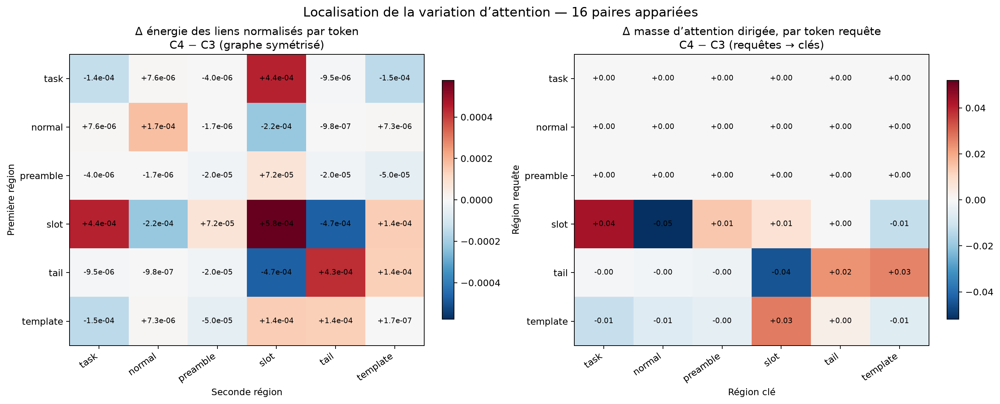

# Recapture C3/C4 : énergie d’attention par régions

- Qwen 2.5 1.5B; 16 paires; 4 exemples par type d’attaque; tâches gigaword, hsol, sentiment, spam.
- C3/C4 appariés exactement en longueur; captures brutes vérifiées causalement; 28 couches × 12 têtes.
- Unité statistique : prompt; bootstrap stratifié par type d’attaque, 10 000 rééchantillonnages.
- Tests exploratoires; BH sur 21 blocs régionaux et 36 flux dirigés.
- Résidu de l’identité variance-spectre sur une matrice : 0.000e+00.

## Effet général

- Δ variance spectrale primaire : +0.00094209.
- Δ énergie hors diagonale par token : +0.000904252.
- Δ contribution des boucles propres : +3.78374e-05.

14 des 21 blocs régionaux ont q<0,05 après BH (7 hausses, 7 baisses). Parmi les flux dirigés, 10/36 passent q<0,05 (4 hausses, 6 baisses). L’augmentation de variance primaire est de 0,000942; 0,000904 (96 %) vient des liens hors diagonale et 0,000038 des boucles.

## Blocs de régions avec les plus fortes variations absolues

| Bloc | Δ énergie/token | IC 95 % | Δ poids carré moyen/lien possible | q BH |
|---|---:|---:|---:|---:|
| slot--slot | +0.0005765 | [+0.0003222, +0.0008103] | +0.0002412 | 0.00344 |
| slot--tail | -0.0004723 | [-0.0006269, -0.000317] | -6.229e-05 | 0.00128 |
| task--slot | +0.0004419 | [+0.0002328, +0.0007187] | +6.24e-05 | 0.000641 |
| tail--tail | +0.0004276 | [+0.0003098, +0.0005398] | +0.0001065 | 0.000641 |
| normal--slot | -0.0002172 | [-0.0002823, -0.0001529] | -2.959e-05 | 0.00498 |
| normal--normal | +0.0001735 | [+0.0001337, +0.0002103] | +3.02e-05 | 0.00229 |
| task--template | -0.0001509 | [-0.000202, -0.0001062] | -5.174e-05 | 0.000641 |
| slot--template | +0.0001436 | [+7.383e-05, +0.0002081] | +5.778e-05 | 0.0151 |

Les quatre moyennes par type d’attaque pour Δ variance primaire sont positives : combine +0,000946, escape +0,000819, ignore +0,000552, naive +0,001452 (4 paires par type; descriptif seulement).

## Flux dirigés d’attention

| Région requête → région clé | Δ masse moyenne C4−C3 | IC 95 % | q BH |
|---|---:|---:|---:|
| slot → normal | -0.05193 | [-0.06403, -0.0396] | 0.00137 |
| tail → slot | -0.04477 | [-0.06179, -0.02904] | 0.00128 |
| slot → task | +0.04301 | [+0.03245, +0.05317] | 0.000439 |
| template → slot | +0.02687 | [+0.02094, +0.03363] | 0.000366 |
| tail → template | +0.02594 | [+0.01702, +0.03536] | 0.00137 |
| tail → tail | +0.02334 | [+0.01755, +0.02904] | 0.000366 |
| slot → preamble | +0.01403 | [+0.005887, +0.02188] | 0.13 |
| slot → template | -0.01241 | [-0.02679, +0.001587] | 0.605 |

## Limites

Pilote exploratoire : 16 paires, un modèle. Pour les attaques ignore/combine, le préambule conservé dans C3 contient déjà une composante adversariale; interpréter les effets par strate. La région slot désigne l’instruction injectée en C4 et le filler en C3.